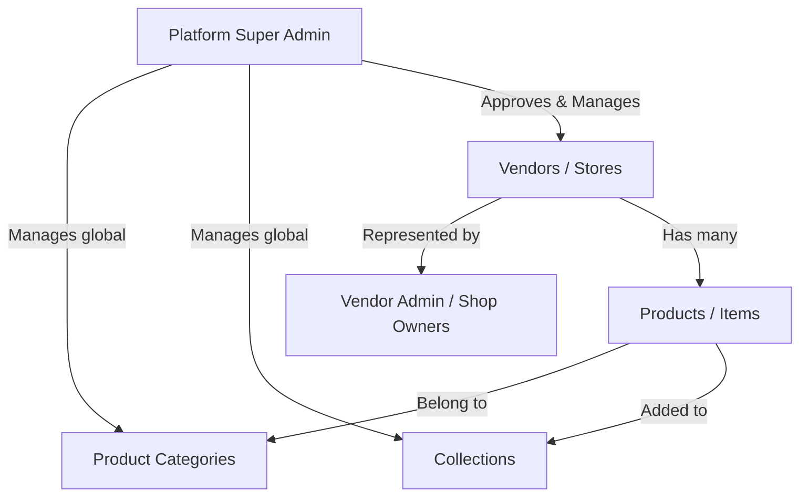

# Marketplace Documentation — Multivendor E-Commerce Architecture

Welcome to the Medusa E-Commerce Marketplace. This document explains the vendor architecture, how products are associated with different stores (magazines), and how collections, categories, and vendors are managed in the Medusa Admin Panel.

---

## 1. Marketplace Core Architecture

The architecture is built on **MedusaJS v2** (backend) and **Next.js** (storefront & vendor portal). It maps relations between platform administrators, vendor stores, and products.



### Key Concepts:
1. **Platform Owner (Super Admin):** Controls the marketplace. Manages the global category taxonomy, promotional collections, transaction commissions, and approves vendors.
2. **Vendor (Magazine / Store):** An independent merchant profile (e.g., *"Ютрейд"*, *"Axma Shop"*). In the database, this is represented by the custom `Vendor` entity.
3. **Product (Item):** Standard Medusa `Product` objects, which are linked to a single `Vendor` ID via a **Module Link** junction table (`vendor_product`).

---

## 2. Managing Collections and Categories via the Medusa Admin

Categories and collections are managed globally to ensure a clean, unified browsing hierarchy (similar to Ozon/Amazon) instead of letting every vendor create a messy category list.

### How to Create & Manage Product Categories:
1. Log in to your **Medusa Admin Panel** (default: `admin.yourdomain.com` or `http://localhost:9000/app`).
2. On the left sidebar, navigate to **Settings** > **Product Categories** (or directly in the **Products** section depending on your admin layout version).
3. Click **Create Category**.
4. Define:
   * **Name:** (e.g., `Мониторы` or `Компьютеры и периферия`)
   * **Handle:** (auto-generated URL slug, e.g., `/monitors`)
   * **Parent Category:** Set hierarchical relations (e.g. nest `Мониторы` under `Компьютеры и периферия`).
5. Products can then be assigned to these categories. The storefront queries these categories to render the navigation menu and category filters.

### How to Create & Manage Collections:
1. In the Admin Panel sidebar, click on **Products** > **Collections**.
2. Click **Create Collection** in the top right corner.
3. Define:
   * **Title:** (e.g., `Летняя распродажа` or `Оригинальная косметика`)
   * **Handle:** (URL slug, e.g., `/summer-sale`)
4. Once created, you or vendors can attach products to these collections. The storefront uses these IDs to render landing grids (e.g. the homepage *"Популярное"* list).

---

## 3. How to Create and Link Vendors (Stores)

In a custom Medusa v2 marketplace, vendors represent independent sellers. Since the `Vendor` module is custom-built, we onboard and manage them through API integrations and administrative extensions:

### A. Automatic Vendor Sign-up (Storefront Onboarding)
* When a merchant clicks **"Стать продавцом"** on the storefront, the app sends a request to the backend's vendor registration route.
* This executes the `createVendorWorkflow` which:
  1. Creates a **Vendor profile** (naming their store, logo, and slug handle).
  2. Registers their **VendorAdmin** authentication credentials.
  3. Drops the store in your queue as unapproved (`is_approved: false`).

### B. Creating and Approving Vendors via the Admin Panel
To manage vendors directly within your Medusa Admin dashboard, the platform is configured to use **Admin Customizations (Widgets & Custom Routes)**:

1. **Custom Vendors Route:**
   * A custom administration page is registered at `src/admin/routes/vendors/page.tsx` using the `@medusajs/admin-sdk`.
   * This displays a database list of all registered shops, showing their:
     * Store Name
     * Handle Slug
     * Verification status
     * Set Commission Rate (e.g., `10` for 10% platform commission cut)
2. **Creating a Store Manually:**
   * In the **Vendors** section of the admin panel, click **Add Vendor**.
   * Fill out the store's profile form (Name, URL Handle, and primary seller email).
   * Submitting invokes the backend's `createVendorWorkflow` to insert the vendor and set up their dashboard credentials.
3. **Approving a Store:**
   * Select a pending vendor from the list and click **Approve Vendor**. This executes the `approveVendorWorkflow` on the backend, enabling the vendor to upload products and accept payments.

---

## 4. How Items (Products) are Filtered by Magazine and Category

To fetch and search items on the frontend storefront, the application requests resources from Medusa's API using standard filter parameters:

### Filtering by Category or Collection:
The storefront sends standard GET filters:
* **ByCategory:** `GET /store/products?category_id=prodcat_01JJ...`
* **ByCollection:** `GET /store/products?collection_id=col_01JJ...`

### Filtering by Store (Magazine):
To display a specific store's landing page (like showcasing only products sold by *"Ютрейд"*), we filter by the linked vendor ID using the Medusa Remote Query graph:
```typescript
// Query products linked to a specific vendor
const { data: products } = await query.graph({
  entity: "product",
  fields: ["id", "title", "thumbnail", "vendor.*"],
  filters: { 
    "vendor.id": "vendor_utrade_id" 
  },
})
```

---

## 5. Summary of the Merchant Flow
1. **You (Super Admin)** setup global categories (`Электроника > Мониторы`) and promotional collections.
2. **Vendors** get approved and log in to their dashboard (`vendor-portal`).
3. **Vendors upload items** under a specific Category. The backend automatically inserts the product and links it to the merchant's ID in the `vendor_product` table.
4. **Customers browse the Storefront**, filtering products by category, collection, or merchant.
